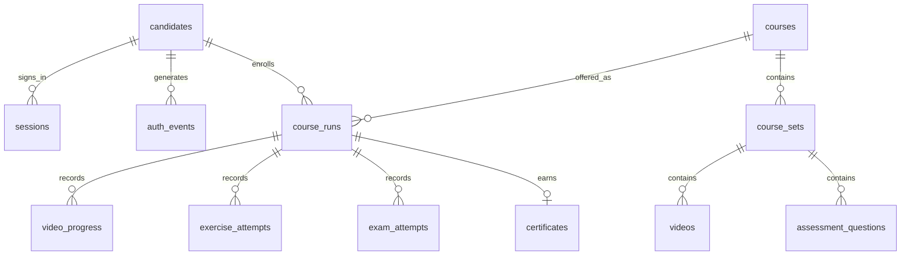

# SQLite data model

The schema lives in `backend/database/schema.sql`. It is automatically initialized at startup. Foreign keys are enabled on every connection; WAL mode and transactional writes support concurrent local requests. Schema version is tracked through SQLite `user_version`.

| Table | Stored records |
| --- | --- |
| `candidates` | Candidate ID, name, unique email, password hash, role, mandatory password-change flag, active status, creating admin, timestamps |
| `sessions` | Hashed session token, candidate relationship, CSRF token, expiry |
| `auth_events` | Registration, successful/failed login, logout, password change; rate-limit timestamps |
| `courses` | Course title, version, category, description, publication status, lesson/curriculum JSON, creating admin |
| `course_sets` | Three ordered sets within the course |
| `videos` | Video IDs, owning set, expected duration |
| `assessment_questions` | Private prompts, options, correct answers, practice explanations |
| `course_runs` | Every enrollment/restart, owning candidate, run number, completion/archive timestamps |
| `video_progress` | Per-run video watch position, completion time, update time |
| `exercise_attempts` | Every practice submission, selected answers, score, pass result, timestamp |
| `exam_attempts` | Every exam attempt, number, deadline, answers, score, status, termination reason |
| `certificates` | One certificate per completed run, candidate-name snapshot, course, issue time |
| `admin_events` | Acting admin, action, target record, non-secret detail, timestamp |

There is exactly one current course run per candidate/course; restarting archives it and creates the next run. Exam numbers are limited to 1–3 by constraints, with a unique number per set/run and at most one active exam per run. Certificates are generated only after server-validated completion. Failed exercises remain in history even after later success. A restart never deletes the candidate's earlier learning records.

To inspect locally with a SQLite viewer, open `backend/data/lms.sqlite3`. Avoid committing this file because it contains candidate data. The app's **My profile → Download my learning records** exports only the signed-in candidate's profile and history, excluding password hashes and sessions.

## Version 3: employee learning & development

The accounts table keeps its historical name, `candidates`, so existing references keep working; every row is an employee. Migration `003_employee_development.sql` rebuilds that table so roles can be `admin`, `hr`, `trainer`, `manager` or `employee`, and adds `department_id`, `job_role_id`, `manager_id` and `job_title`. Former `candidate` accounts become `employee`, with passwords and history preserved. `courses` gains `difficulty`, `duration_minutes`, `department_id`, `trainer_id`, `pass_percent`, `max_attempts` and `post_assessment_id`.

| Table | Stored records |
| --- | --- |
| `departments`, `job_roles`, `course_categories` | Configurable organisation data (defaults are seeded once into empty tables) |
| `skills`, `course_skills`, `role_competencies` | Skill library, skills a course develops, target levels per job role |
| `skill_evidence` | Assessment- or manager-recorded proficiency with notes; the current level is the highest evidence |
| `learning_goals`, `development_records` | Personal goals and self-reported external learning |
| `course_assignments`, `path_assignments` | Assignments to an employee, department or job role, with mandatory flag and due date |
| `learning_paths`, `learning_path_courses` | Ordered course sequences |
| `assessments`, `assessment_bank`, `assessment_attempts` | Question banks, rules, and every randomised attempt with score |
| `training_sessions`, `session_registrations` | Instructor-led sessions, seats, registration and attendance |
| `notifications` | In-app notifications, unique per employee and dedupe key |
| `materials`, `course_resources` | Private uploaded files and course learning materials |
| `assistant_usage` | AI assistant request timestamps for per-employee rate limits |

### Imported courses

Courses imported from a URL use the existing `courses` and `course_lessons` tables, with no new tables. Columns are added automatically to existing databases.

| Column | Purpose |
| --- | --- |
| `courses.source_url` | Normalised original address (indexed; used to prevent importing the same source twice) |
| `courses.source_platform` | Platform name, or the site's host name, shown as attribution |
| `courses.import_status` | `complete`, `partial` (some lessons not retrieved) or `reference`; empty for courses created by hand |
| `courses.import_report_json` | Per-lesson outcome (imported, not retrieved with reason, or reference), licence, strategy and date |
| `course_lessons.module_index`, `module_title` | The source module a lesson belongs to; consecutive lessons with the same index form one module. `NULL` for top-level lessons |
| `course_lessons.source_url` | The lesson's original page |

Lesson order is `course_lessons.position`. Section headings, lists, tables and code stay in order inside `course_lessons.content`, as lesson Markdown.

Version 2 is initialized automatically. Migration `002_roles_and_courses.sql` upgrades existing version 1 accounts and progress, defaults their role to candidate, and preserves personalized passwords. The first admin is created/promoted through the one-time local browser setup page. Public registration is disabled.
